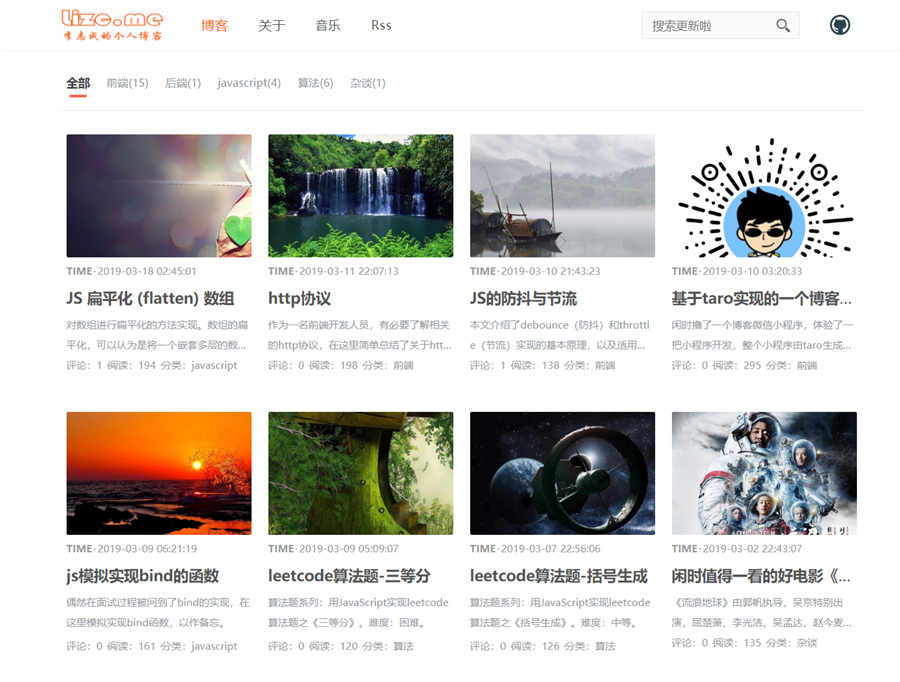

<h1 align="center">Node Blog</h1>

<div align="center">

💨 A simple, fast and easy-to-use blog 🚀

⚠️ Caution: Working in progress - It's not production ready 🚧

[](https://github.com/bs32g1038/node-blog/actions) [](https://github.com/bs32g1038/node-blog/actions)
[](https://coveralls.io/github/bs32g1038/node-blog?branch=master)


</div>

<p align="center" dir="auto">

</p>

## Features

* 🌙☀ Theme: Support light and dark themes
* 🐐 APi: Node-blog through Nodejs and express provide the Restful API
* 🚜 Database: Data stored in Mongodb，Driven by Mongoose
* 🔨 Powerful build: Use powerful webpack to build projects
* 🍓 Framework support: React, Ant design, Express, Typescript, ...
* 🌲 Nextjs: Support server-side render
* 📲 Responsive: Responsive layout for mobile-side
* ⚙️ Best Practices: Solid workflow to make your code healthy
* ......

## Structure
```
ROOT
│
├─server // provide blog server api, based one nodejs, mongodb
│
client // client ui
│
├──web // front-end ui
│
├──admin // admin ui
│
├─docker-compose.yml // docker-compose config file
```

## Todo
- [x] Article tags
- [x] Writing new article in browser
- [x] Comments
- [x] Search support
- [x] Mobile web support
- [x] Light theme &  Dark theme
- [x] Article draft record
- [x] Other support ...

## Development

**1，clone code**
```
git clone https://github.com/bs32g1038/node-blog.git
```

**2，install**
```
cd **
npm install
```

**3，init database data**
```
// this will generate the faker data to database
npm run init:dev:data
```

**4，run app**
```
npm run dev     // development mode
```

**4, build dist**
```
npm run build   // build dist for server and client
```

## Deploy

The project has integrated related suites, such as client ui, dockerfile, docker-compose.yml. So you can easy to deploy the project.

* First: I recommend that you debug locally and make changes to configuration information, such as database information and personal information.

* Secondly: you can choice the docker to deploy this project. It is very esay. you only ```pull``` the project to your server and install ```docker```, and run ```docker-compose build``` command, and run ```docker-compose up -d``` command

**However!!!⚠**

If you don't want to use docker, you must to ```cd``` the current item and run ```npm install or yarn install``` command.

At the same time, when finish install, you need to run ```npm run start:prod``` command.

Besides, you may need to install ```mongodb```,before you run the application.

## Environment dependence

Operating System: Linux, OS X or Windows.

Node.js Runtime: 20.x or newer; it is recommended that you use LTS Releases.

database: mongdb 5.x or newer;

## Browsers support

Modern browsers.

| [](http://godban.github.io/browsers-support-badges/)</br>Edge | [](http://godban.github.io/browsers-support-badges/)</br>Firefox | [](http://godban.github.io/browsers-support-badges/)</br>Chrome | [](http://godban.github.io/browsers-support-badges/)</br>Safari | [](http://godban.github.io/browsers-support-badges/)</br>Opera |
| --- | --- | --- | --- | --- |
| Edge | last 2 versions | last 2 versions | last 2 versions | last 2 versions |

## Thank you：

If you think these contents are useful to you, please add a "Star" at the top right. This is the encouragement to me, thank you!

# License
MIT
